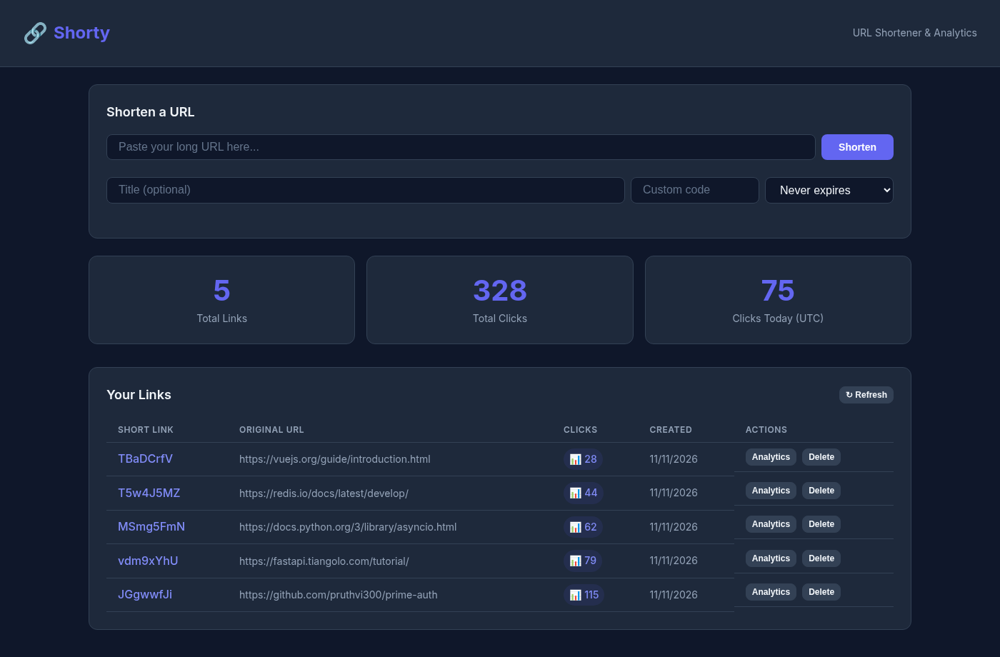
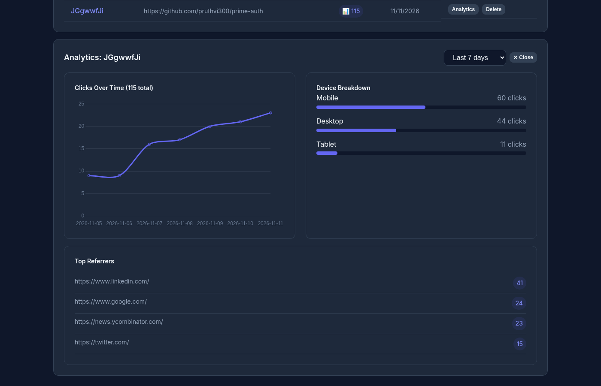

# Shorty — URL Shortener with Analytics

[](https://github.com/pruthvi300/shorty/actions/workflows/ci.yml)


A full-stack **URL shortening service** with real-time click analytics. Built with Flask (backend) and Vue 3 (frontend).

## 📸 Screenshots

**Dashboard**: shorten links, see totals, manage your links



**Per-link analytics**: clicks over time, device breakdown and top referrers



## 🎯 Features

- **URL Shortening**: Generate short, memorable links
- **Click Analytics**: Track clicks, locations, referrers, devices
- **Analytics Dashboard**: Vue.js dashboard with charts
- **Custom Aliases**: Create branded short links
- **Link Management**: Rename, deactivate, delete, and expiring links
- **Redis cache-aside** on the redirect path, with invalidation and graceful fallback when Redis is down

## 🏗️ Architecture

```
┌─────────────────────────────────────────────────────────────────────────────┐
│                            SHORTY ARCHITECTURE                            │
├─────────────────────────────────────────────────────────────────────────────┤
│                                                                              │
│   ┌─────────────────┐         ┌─────────────────┐                           │
│   │   Vue 3 SPA     │ ◀─────▶ │   Flask API     │                           │
│   │   Dashboard     │  JSON   │   (REST)        │                           │
│   └─────────────────┘         └────────┬────────┘                           │
│                                        │                                     │
│                               ┌────────┴────────┐                           │
│                               │                 │                            │
│                               ▼                 ▼                            │
│                        ┌───────────┐     ┌───────────┐                      │
│                        │  MySQL     │     │   Redis   │                      │
│                        │  (Data)   │     │  (Cache)  │                      │
│                        └───────────┘     └───────────┘                      │
│                                                                              │
└─────────────────────────────────────────────────────────────────────────────┘
```

## 🛠️ Tech Stack

| Layer | Technology | Purpose |
|-------|------------|---------|
| **Backend** | Flask 3.0 | REST API, URL routing |
| **ORM** | SQLAlchemy | Database operations |
| **Frontend** | Vue 3 + Composition API | Interactive dashboard |
| **Charts** | Chart.js | Analytics visualization |
| **Database** | MySQL | Link & analytics storage |
| **Cache** | Redis | Redirect caching |
| **Container** | Docker Compose | Development & deployment |

## ⚡ Quick Start

### With Docker (Recommended)

```bash
git clone https://github.com/pruthvi300/shorty.git
cd shorty
docker compose up --build
```

**Access:**
- Frontend: http://localhost:5173
- API: http://localhost:5000
- Health: http://localhost:5000/health

### Local Development

```bash
# Backend
cd api
python -m venv venv
source venv/bin/activate
pip install -r requirements-dev.txt
export DATABASE_URL=sqlite:///shorty.db REDIS_URL=   # or point at MySQL/Redis
flask --app app:create_app db upgrade
flask --app app:create_app run

# Frontend (new terminal)
cd frontend
npm install
npm run dev
```

## 📦 Project Structure

```
shorty/
├── api/                     # Flask Backend
│   ├── app/
│   │   ├── __init__.py      # App factory
│   │   ├── config.py        # Environment-based settings
│   │   ├── cache.py         # Redis cache-aside for redirects
│   │   ├── models.py        # SQLAlchemy models
│   │   ├── routes/          # API blueprints
│   │   │   ├── links.py     # Link CRUD
│   │   │   ├── redirect.py  # /<short_code> hot path
│   │   │   └── analytics.py # Analytics endpoints
│   │   └── utils.py         # Validation, UA parsing
│   ├── migrations/          # Flask-Migrate (Alembic)
│   ├── tests/               # pytest (SQLite + fakeredis)
│   ├── requirements.txt
│   └── Dockerfile
├── frontend/                # Vue 3 Frontend
│   ├── src/
│   │   ├── api.js           # axios client
│   │   └── App.vue
│   ├── package.json
│   └── Dockerfile
├── docker-compose.yml
└── README.md
```

## 🔑 API Endpoints

| Method | Endpoint | Description |
|--------|----------|-------------|
| POST | `/api/links` | Create short link |
| GET | `/api/links` | List links (paginated) |
| GET | `/api/links/{id}` | Get link details |
| PATCH | `/api/links/{id}` | Update title / active flag |
| DELETE | `/api/links/{id}` | Soft-delete link |
| GET | `/api/analytics/summary` | Dashboard totals |
| GET | `/api/analytics/links/{id}` | Link analytics |
| GET | `/{short_code}` | Redirect to original URL |

## 🧪 Testing

```bash
cd api
pip install -r requirements-dev.txt
pytest -v      # 34 tests: validation, caching, invalidation, expiry, analytics
ruff check app tests
```

> **Note:** there is no authentication. Anyone who can reach the API can list and delete links. Add auth before exposing it publicly.

## 📚 More

Architecture, data model and design decisions: [docs/DESIGN.md](docs/DESIGN.md)

## 📝 License

[MIT](LICENSE)
